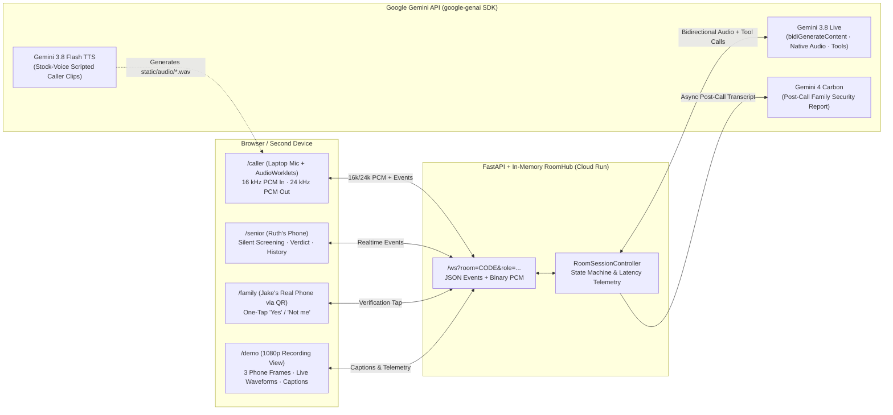

# Vouch

**Stop family impersonation scams before an older adult's phone ever rings.**

Vouch is a real-time AI call screener built with the **Gemini Live API** (`gemini-3.8-live`), **Gemini 4 Carbon** (`gemini-4-carbon`), and **Gemini TTS** (`gemini-3.8-flash-tts`) for the Berkeley x DeepMind Hackathon.

> **Hosted Prototype:** *(Deploy with `scripts/deploy.sh` — see Cloud Run section below or `MORNING.md`)*

---

## What Vouch Does

Scammers increasingly use spoofed local numbers and panicked urgency (*"Grandma, it's Jake, I'm in jail, I need $4,000 for bail — please don't tell Mom"*) or fake bank security alerts to steal older adults' savings. Rather than guessing whether a voice is synthetic, **Vouch verifies identity claims out-of-band before ringing the senior's phone**:

1. **Unknown callers talk to Vouch first:** Vouch always announces itself as Ruth's assistant while Ruth's phone stays silent.
2. **Routine business rings right through:** Legitimate everyday calls (e.g., Elm Street Pharmacy confirming a prescription pickup) are passed through with a one-line summary.
3. **Bank, government & tech-support claims are stopped cold:** Never connected; Ruth is calmly reminded she can call the official number on her card directly.
4. **Family claims trigger a live one-tap check on the real relative's phone:** When someone claims to be Ruth's grandson Jake asking for $4,000 bail, Gemini Live places the caller on hold and pushes a real-time verification card to Jake's phone (`/family?room=CODE`). When Jake taps **Not me**, Vouch immediately speaks out loud — *"Jake says he isn't calling. Goodbye."* — disconnects the call, logs the blocked attempt, and **Gemini 4 Carbon** writes a plain-English security brief for the family.

---

## Two-Command Local Setup

**Prerequisites:** Python 3.11+ with [`uv`](https://docs.astral.sh/uv/) and a `GEMINI_API_KEY` from Google AI Studio.

```bash
cp .env.example .env && make install   # Put your GEMINI_API_KEY in .env
make run                               # Starts FastAPI + WebSocket hub at http://localhost:8080
```

Open **`http://localhost:8080/demo`** in Chrome (wear headphones for live open-mic conversations, or click any of the three scripted caller scenario clips). Scan the on-screen QR code on a second phone to open Jake's verification screen live.

---

## Architecture



---

## Gemini Models & Features Used

| Model | Role in Vouch | Why This Model & Feature |
|---|---|---|
| **`gemini-3.8-live`** *(Gemini Live API)* | Real-time bidirectional voice screener | Streams raw `16 kHz` PCM audio in and `24 kHz` native audio out with automatic VAD (`silence_duration_ms=450`), live input/output audio transcriptions, and live function calling (`request_family_verification`, `block_call`, `pass_through`, `take_message`). Responds in `< 1s` after the family member taps **Not me**. |
| **`gemini-4-carbon`** *(Gemini 4 Carbon)* | Post-call family security report | Runs asynchronously after hangup (`thinking_level="low"` + JSON structured output) so it never adds latency to live voice, turning the raw call transcript into a calm 4-part family brief: *Claim*, *Scam Pattern*, *What Vouch Did*, and *Recommended Next Step*. |
| **`gemini-3.8-flash-tts`** *(Gemini TTS)* | Scripted caller clips & automated test audio | Synthesizes stock-voice (`Puck`, `Charon`, `Zephyr`) caller clips (`static/audio/*.wav`) that drive both the one-click demo buttons on `/caller` and Chromium's `--use-file-for-fake-audio-capture` browser reliability suite. |

Models are discovered dynamically at startup against `GEMINI_API_KEY` (and can be overridden via `VOUCH_LIVE_MODEL`, `VOUCH_REPORT_MODEL`, and `VOUCH_TTS_MODEL`).

---

## Testing & Verification

```bash
make test     # Unit tests (state machine, verification timeout, room isolation, rate limits)
make smoke    # Server-side Live API audio smoke test (WAV -> gemini-3.8-live -> tool -> WAV)
make e2e      # Headless Chromium fake-microphone E2E test driving the full real audio path
```

To run the full 10-run consecutive reliability benchmark + all 3 scripted scenarios:
```bash
uv run python scripts/run_eval.py --runs 10 --scenarios --screenshots
```

---

## Cloud Run Deployment

```bash
gcloud config set project YOUR_GCP_PROJECT_ID
gcloud services enable run.googleapis.com cloudbuild.googleapis.com artifactregistry.googleapis.com
GEMINI_API_KEY="$(grep '^GEMINI_API_KEY=' .env | cut -d= -f2-)" bash scripts/deploy.sh
```

`scripts/deploy.sh` configures `--min-instances=1 --max-instances=1 --timeout=3600 --session-affinity --no-cpu-throttling` so in-memory room state and bidirectional WebSocket audio streams stay pinned and warm.
