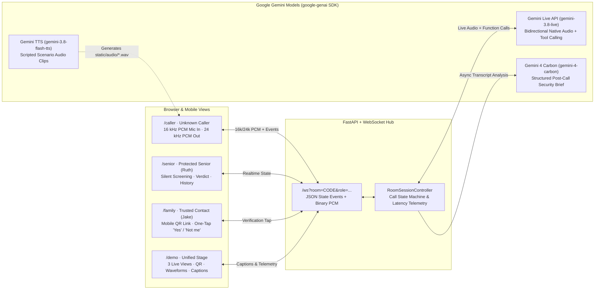

# Vouch

**Stop family impersonation scams before an older adult's phone ever rings.**

> Built for the **Google DeepMind Hackathon** using the **Gemini Live API** (`gemini-3.8-live`), **Gemini 4 Carbon** (`gemini-4-carbon`), and **Gemini TTS** (`gemini-3.8-flash-tts`).

---

## Overview

Phone scammers increasingly combine spoofed local numbers, leaked personal details, and AI-cloned voices to run high-pressure "grandparent" and fake bank-fraud attacks (*"Grandma, it's Jake — I'm in jail and need $4,000 for bail, please don't tell Mom"*). Rather than trying to classify synthetic audio artifacts, **Vouch verifies identity claims out-of-band in real time before ringing the senior's phone**:

1. **Silent screening for unknown numbers:** Unknown callers speak to Vouch first while the protected senior's phone (*Ruth*) stays completely silent.
2. **Everyday calls pass right through:** Legitimate callers (such as a neighborhood pharmacy confirming a prescription pickup) are connected immediately with a concise one-line summary.
3. **Bank, government & tech-support claims are stopped cold:** High-risk institutional impersonators asking to move money or share codes are politely refused and disconnected without ever disturbing Ruth.
4. **Live one-tap family verification:** When an unknown caller claims to be family in an emergency, Gemini Live places the caller on hold and pushes an instant verification card to the real relative's phone (`/family?room=CODE`). One tap on **Not me** causes Vouch to speak out loud (*"Jake says he isn't calling. Goodbye."*), terminate the call, log the blocked attempt, and generate an asynchronous **Gemini 4 Carbon** security brief for the family.

---

## Architecture



### Gemini Models & Capabilities Used

| Model | Role in Vouch | Key Capabilities Used |
|---|---|---|
| **`gemini-3.8-live`** *(Gemini Live API)* | Real-time voice call screener | Raw `16 kHz` PCM input & `24 kHz` native audio output via WebSockets, automatic VAD (`450 ms`), live input/output speech transcription, and live tool calling (`request_family_verification`, `block_call`, `pass_through`, `take_message`). |
| **`gemini-4-carbon`** | Post-call family security report | Runs asynchronously after call completion using JSON structured output to produce a calm 4-part summary (*Claim*, *Scam Pattern*, *Action Taken*, and *Recommended Next Step*) without adding voice latency. |
| **`gemini-3.8-flash-tts`** | Scripted caller clips & E2E audio | Synthesizes multi-voice caller clips (`Puck`, `Charon`, `Zephyr`) used for one-click demo scenarios and automated browser audio testing. |

*(Models are discovered dynamically against your `GEMINI_API_KEY` at startup with automatic fallbacks, and can be overridden via `VOUCH_LIVE_MODEL`, `VOUCH_REPORT_MODEL`, and `VOUCH_TTS_MODEL`.)*

---

## Quickstart

### Prerequisites
- Python **3.11+** and [`uv`](https://docs.astral.sh/uv/)
- A `GEMINI_API_KEY` from [Google AI Studio](https://aistudio.google.com/)

### 1. Install & Configure
```bash
cp .env.example .env      # Add your GEMINI_API_KEY to .env
make install              # Installs dependencies via uv
```

### 2. Run Locally
```bash
make run                  # Starts FastAPI + WebSocket hub on http://localhost:8080
```

Open **`http://localhost:8080/demo`** in Chrome:
- **Live voice:** Plug in headphones (recommended for open-mic conversations) and click **Call Ruth** on the left phone, or click any of the three **Scripted Caller Clips** (*Grandson in jail*, *Bank fraud department*, *Elm Street Pharmacy*).
- **Second-device phone check:** Scan the on-screen QR code with your phone to open Jake's verification screen (`/family?room=CODE`) and tap **Not me** live.
  - On shared local Wi-Fi, Vouch automatically encodes your machine's LAN IP into the QR code.
  - On isolated campus/guest Wi-Fi or 5G cellular, run **`make tunnel`** instead of `make run` to spin up an instant HTTPS tunnel wired directly into the QR code.
- **UI preview mode (no API key required):** Run `make mock`.

---

## Project Structure

```text
vouch/
├── server/
│   ├── main.py              # FastAPI routes, WebSocket endpoint, dynamic QR SVG endpoint
│   ├── hub.py               # Multi-room state coordinator, tool handlers & rate limiting
│   ├── live_session.py      # Gemini Live API bidirectional audio & tool-call bridge
│   ├── report.py            # Async Gemini 4 Carbon structured post-call security brief
│   ├── mock_session.py      # Offline deterministic mock session for UI preview & unit tests
│   ├── models.py            # Call state machine, room snapshots & latency telemetry
│   ├── config.py            # Runtime model discovery & LAN/public URL resolution
│   ├── contacts.json        # Protected senior & verified family contact directory
│   └── prompts/screener.md  # System instructions for the real-time Vouch voice screener
├── static/
│   ├── demo.html            # Unified 3-phone live stage with QR sidebar, waveforms & captions
│   ├── caller.html          # Unknown caller phone UI (mic capture + scripted scenario clips)
│   ├── senior.html          # Protected senior (Ruth) UI
│   ├── family.html          # Trusted relative (Jake) mobile verification UI
│   ├── js/                  # Web Audio API 16k/24k PCM AudioWorklets & view controllers
│   ├── css/styles.css       # Responsive UI & stage styling
│   └── audio/               # Gemini TTS caller scenario clips (.wav)
├── scripts/
│   ├── deploy.sh            # One-command Google Cloud Run deployment
│   ├── run_tunnel.py        # Instant HTTPS tunnel helper for mobile QR scanning
│   ├── generate_clips.py    # Regenerates caller .wav clips via Gemini TTS
│   ├── audio_smoke.py       # Headless Gemini Live API audio-in/audio-out smoke test
│   └── run_eval.py          # Multi-run browser E2E latency & reliability benchmark
└── tests/
    ├── test_unit.py         # State machine, room isolation, timeout & API unit tests
    └── test_hero_e2e.py     # Headless Chromium fake-microphone full-pipeline E2E test
```

---

## Testing & Cloud Run Deployment

### Run Tests
```bash
make test     # Fast unit tests (state machine, room isolation, QR resolution, rate limits)
make smoke    # Live Gemini audio smoke test (16 kHz WAV -> Gemini Live -> tool call -> 24 kHz WAV)
make e2e      # Full Chromium AudioWorklet -> WebSocket -> Gemini Live E2E test
```

### Deploy to Google Cloud Run
```bash
gcloud config set project YOUR_GCP_PROJECT_ID
bash scripts/deploy.sh
```
`scripts/deploy.sh` deploys the container with `--session-affinity` and pinned instance state so live multi-device rooms and bidirectional WebSocket audio streams stay synchronized.
